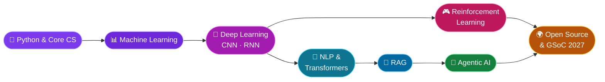

<!-- ═══════════════════════════ HERO ═══════════════════════════ -->
<div align="center">


<a href="https://github.com/muskanmundra18-lab">
  
</a>

<br/><br/>


<br/><br/>

<a href="https://www.linkedin.com/in/muskan-mundra-50b58a210/"></a>
<a href="https://github.com/muskanmundra18-lab?tab=repositories"></a>
<a href="https://github.com/muskanmundra18-lab?tab=followers"></a>

</div>


<!-- ═══════════════════════════ ABOUT ═══════════════════════════ -->
## 🌸 About Me

<table>
<tr>
<td width="58%" valign="top">

```python
class Muskan:
    def __init__(self):
        self.role      = "AI/ML Enthusiast 🤖"
        self.studying  = "B.Tech, Electronics &"
        self.studying += " Instrumentation @ SGSITS 🎓"
        self.exploring = ["Generative AI", "RAG",
                          "Agentic AI"]
        self.building  = ["ML", "Deep Learning",
                          "Reinforcement Learning"]
        self.goal      = "Open Source & GSoC 2027 🌍"

    def motto(self):
        return "Always learning, experimenting, " \
               "and turning ideas into projects ✨"
```

</td>
<td width="42%" valign="top">

🔭 **Currently exploring**
Generative AI, RAG & Agentic AI

🛠️ **Currently building**
ML, Deep Learning & RL projects

🎯 **Working toward**
Open-source contributions & GSoC 2027

💡 **I love**
Turning ideas into practical AI apps that solve real problems

</td>
</tr>
</table>


<!-- ═══════════════════════════ TECH STACK ═══════════════════════════ -->
## 🧰 Tech Stack

<div align="center">

| | |
| :---: | :--- |
| **🔤 Languages** |  |
| **🧠 ML & DL** |  |
| **⚙️ Backend & Apps** |   |
| **🗄️ Databases & Tools** |  |

<br/>


<br/>


</div>


<!-- ═══════════════════════════ PROJECTS ═══════════════════════════ -->
## 🚀 Featured Projects

<div align="center">

<table>
<tr>
<td width="50%" valign="top">

### 📄 [Research Paper Analyser](https://github.com/muskanmundra18-lab/research-paper-analyser)
A **RAG pipeline** that analyses scientific papers and answers your questions about them.

`Python` `RAG` `Streamlit`

</td>
<td width="50%" valign="top">

### 🎬 [YouTube Video Analyser](https://github.com/muskanmundra18-lab/YouTube_video_analyser)
An **AI agent** that analyses YouTube videos and pulls out the information that matters.

`Python` `Agno` `Streamlit`

</td>
</tr>
<tr>
<td width="50%" valign="top">

### 🐦 [Flappy Bird AI](https://github.com/muskanmundra18-lab/Flappy-bird)
Training a **reinforcement learning** neural network to master Flappy Bird.

`Python` `Reinforcement Learning` `Neural Nets`

</td>
<td width="50%" valign="top">

### 🖼️ [CNN · CIFAR-10](https://github.com/muskanmundra18-lab/CNN-CIFAR10)
A **convolutional neural network** for image classification on CIFAR-10.

`Python` `CNN` `Deep Learning`

</td>
</tr>
<tr>
<td width="50%" valign="top">

### 💬 [Sentiment Analysis](https://github.com/muskanmundra18-lab/sentiment-analysis)
An **RNN** that classifies IMDB movie reviews as positive, negative, or neutral.

`Python` `RNN` `NLP`

</td>
<td width="50%" valign="top">

### 📝 [Text Summariser](https://github.com/muskanmundra18-lab/text-summariser)
Text summarisation powered by **Hugging Face Transformers**.

`Python` `Transformers` `NLP`

</td>
</tr>
<tr>
<td colspan="2" align="center">

### 🛒 [SmartCart Clustering](https://github.com/muskanmundra18-lab/smartcart-clustering)
A customer segmentation system built with **unsupervised ML algorithms**.

`Python` `Scikit-learn` `Clustering`

</td>
</tr>
</table>

<a href="https://github.com/muskanmundra18-lab?tab=repositories">
  
</a>

</div>


<!-- ═══════════════════════════ LEARNING JOURNEY ═══════════════════════════ -->
## 🗺️ My Learning Journey




<!-- ═══════════════════════════ NOW ═══════════════════════════ -->
## 🌱 Currently Exploring

| 🔭 Focus | 💡 What I'm up to |
| :-- | :-- |
| 🔎 **Retrieval-Augmented Generation** | Better chunking, embeddings, retrieval and context-aware answers |
| 🤖 **Agentic AI** | Agents that reason, use tools and complete multi-step tasks |
| 🧠 **Deep Learning** | Neural networks, CNNs and model evaluation |
| 🌍 **Open Source** | Preparing contributions and working toward **GSoC 2027** |


<!-- ═══════════════════════════ STATS ═══════════════════════════ -->
## 📊 GitHub Stats

<div align="center">


</div>

<!-- ═══════════════════════════ SNAKE ═══════════════════════════ -->
<!-- Needs .github/workflows/snake.yml (provided separately). Delete this block if you skip the snake. -->
<div align="center">
  <picture>
    <source media="(prefers-color-scheme: dark)" srcset="https://raw.githubusercontent.com/muskanmundra18-lab/muskanmundra18-lab/output/github-snake-dark.svg"/>
    <source media="(prefers-color-scheme: light)" srcset="https://raw.githubusercontent.com/muskanmundra18-lab/muskanmundra18-lab/output/github-snake.svg"/>
    
  </picture>
</div>


<!-- ═══════════════════════════ CONNECT ═══════════════════════════ -->
## 💌 Let's Connect

<div align="center">

<a href="https://www.linkedin.com/in/muskan-mundra-50b58a210/"></a>
<a href="https://github.com/muskanmundra18-lab"></a>

<br/><br/>

💬 Ask me about **RAG, AI agents, deep learning or open source**
🤝 Open to collaborating on **AI/ML projects & open-source contributions**

<br/>


</div>